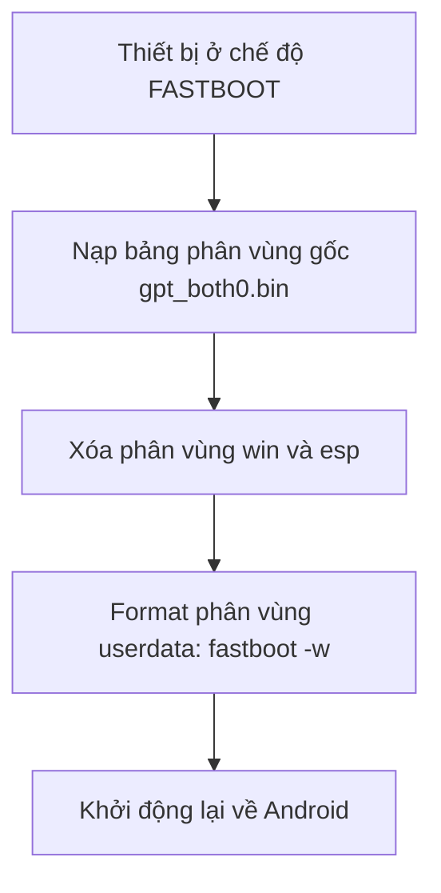

# 📖 HƯỚNG DẪN SỬ DỤNG TOÀN TẬP - RESTORE MI PAD 5 PRO
> 🌟 **Created by ITK** • Cẩm nang khôi phục Android gốc từ Windows 11 Dual-Boot, dọn dẹp hệ thống và tối ưu hóa toàn diện cho Xiaomi Pad 5 (`nabu`)

---

## 📑 MỤC LỤC
1. [Giới Thiệu Chung](#-1-giới-thiệu-chung)
2. [Chuẩn Bị & Cài Đặt Môi Trường](#-2-chuẩn-bị--cài-đặt-môi-trường)
3. [Hướng Dẫn Khôi Phục Về Android Gốc (1-Click Restore)](#-3-hướng-dẫn-khôi-phục-về-android-gốc-1-click-restore)
4. [Hướng Dẫn Dọn Rác & Gỡ Bỏ Quảng Cáo Xiaomi (Debloat)](#-4-hướng-dẫn-dọn-rác--gỡ-bỏ-quảng-cáo-xiaomi-debloat)
5. [Hướng Dẫn Dùng Kho Tiện Ích Tuyển Chọn (Tab 2)](#-5-hướng-dẫn-dùng-kho-tiện-ích-tuyển-chọn-tab-2)
6. [Tối Ưu Màn Hình, DPI & Tần Số Quét 120Hz (Tab 4)](#-6-tối-ưu-màn-hình-dpi--tần-số-quét-120hz-tab-4)
7. [Cẩm Nang Thủ Thuật & Tối Ưu Thực Chiến HyperOS / MIUI](#-7-cẩm-nang-thủ-thuật--tối-ưu-thực-chiến-hyperos--miui)
   - [7.1. Chặn 100% Quảng cáo & Mã độc qua DNS Riêng Tư](#71-chặn-100-quảng-cáo--mã-độc-qua-dns-riêng-tư)
   - [7.2. Xử lý triệt để Magisk tự phục hồi sau khi reboot](#72-xử-lý-triệt-để-magisk-tự-phục-hồi-sau-khi-reboot)
   - [7.3. Tạo lối tắt Bật/Tắt Chế độ Máy Trạm (Workstation Mode)](#73-tạo-lối-tắt-bậttắt-chế-độ-máy-trạm-workstation-mode)
   - [7.4. Bật phát âm thanh đồng thời 2 ứng dụng](#74-bật-phát-âm-thanh-đồng-thời-2-ứng-dụng)
   - [7.5. Cách ẩn ứng dụng và quản lý Không Gian Thứ Hai](#75-cách-ẩn-ứng-dụng-và-quản-lý-không-gian-thứ-hai)
8. [Khắc Phục Sự Cố Thường Gặp (Troubleshooting FAQ)](#-8-khắc-phục-sự-cố-thường-gặp-troubleshooting-faq)

---

## 🌟 1. GIỚI THIỆU CHUNG
**RestoreMiPad5 Pro** là phần mềm giao diện đồ họa (PyQt6 Dark Mode) được phát triển riêng cho máy tính bảng **Xiaomi Pad 5 (tên mã: `nabu`)**. 

Phần mềm giải quyết trọn gói các vấn đề:
* Tự động xóa phân vùng khởi động UEFI (`esp`) và phân vùng chứa Windows (`win`).
* Nạp lại bảng phân vùng gốc Qualcomm LUN0 GPT chính hãng (`gpt_both0.bin`).
* Mở rộng lại phân vùng `userdata` về **100% dung lượng xuất xưởng** (128GB hoặc 256GB).
* Tích hợp sẵn bộ công cụ dọn rác (Debloat), kho ứng dụng tablet mã nguồn mở, tinh chỉnh hiển thị 120Hz và các phím tắt quản lý A/B Slot.

---

## 🛠️ 2. CHUẨN BỊ & CÀI ĐẶT MÔI TRƯỜNG

### 2.1. Yêu cầu thiết bị
* **Xiaomi Pad 5 (`nabu`)**: Mức pin tối thiểu từ **30%** trở lên.
* **Cáp kết nối**: Cáp USB-C chất lượng tốt (khuyến nghị cắm trực tiếp vào cổng USB trên mainboard máy tính, tránh dùng qua cổng HUB chia cổng).
* **Máy tính**: Chạy Windows 10 hoặc Windows 11 (64-bit).

### 2.2. Khởi chạy ứng dụng
1. Tải hoặc sao chép thư mục `RestoreMiPad5` về máy tính.
2. Đảm bảo máy tính đã cài đặt **Python 3.8+** (nếu chưa cài, tải tại [python.org](https://www.python.org/downloads/)).
3. Chạy file **`run.bat`** bằng cách nhấp đúp chuột.
   * *Ghi chú:* Script sẽ tự động kiểm tra và cài đặt các thư viện cần thiết (`PyQt6`, `requests`, v.v.) và mở ứng dụng.

---

## 🚀 3. HƯỚNG DẪN KHÔI PHỤC VỀ ANDROID GỐC (1-CLICK RESTORE)

> [!WARNING]
> Quá trình khôi phục sẽ định dạng lại toàn bộ bộ nhớ trong của máy tính bảng. Toàn bộ dữ liệu của cả Windows 11 và Android sẽ bị xóa sạch. Vui lòng sao lưu dữ liệu quan trọng trước khi thực hiện!

### Bước 1: Kết nối thiết bị
* **Nếu máy đang mở Android:** Cắm cáp USB vào máy tính. Ứng dụng sẽ hiển thị thanh trạng thái màu xanh dương: `ĐÃ KẾT NỐI ANDROID (ADB Online)`. Nhấn nút **⚡ Chuyển sang FASTBOOT** trên giao diện.
* **Nếu máy đang tắt:** Nhấn giữ đồng thời nút **Giảm âm lượng (-) + Nguồn** trong 5 giây đến khi màn hình hiện chữ **FASTBOOT** màu cam, sau đó cắm cáp vào máy tính.

### Bước 2: Bắt đầu khôi phục
1. Quan sát thanh trạng thái ứng dụng chuyển sang màu xanh lá: **`ĐÃ KẾT NỐI CHẾ ĐỘ FASTBOOT (nabu)`**.
2. Tích chọn vào ô: *"Tôi hiểu rằng thao tác này sẽ xóa sạch dữ liệu..."*.
3. Nhấn nút lớn: **🚀 BẮT ĐẦU KHÔI PHỤC VỀ ANDROID GỐC (1-CLICK RESTORE)**.
4. Bấm **Xác nhận (Yes)** tại hộp thoại cảnh báo.



### Bước 3: Hoàn tất khởi động lần đầu
* Máy sẽ khởi động lại. Lần khởi động đầu tiên sẽ mất khoảng **2 - 5 phút** để Android tái tạo bộ nhớ.
* **Nếu máy khởi động vào màn hình Mi-Recovery:**
  1. Dùng phím **Giảm âm lượng** chuyển xuống chọn **`Wipe Data`** -> bấm phím **Nguồn**.
  2. Chọn **`Wipe All Data`** -> bấm **`Confirm`**.
  3. Sau khi xong, chọn **`Back to Main Menu`** -> chọn **`Reboot`** -> chọn **`Reboot to System`**.
* Máy sẽ vào màn hình thiết lập ban đầu của MIUI/HyperOS với **đầy đủ 100% dung lượng bộ nhớ**.

---

## 🧹 4. HƯỚNG DẪN DỌN RÁC & GỠ BỎ QUẢNG CÁO XIAOMI (DEBLOAT)

Tại tab **📦 Quản Lý Ứng Dụng (Tab 3)**:

1. Kết nối tablet qua cáp USB và bật **Gỡ lỗi USB (USB Debugging)** trong Cài đặt nhà phát triển.
2. Bấm nút **⚡ Dọn Dẹp Bloatware 1-Click (Khuyên Dùng)**.
3. Phần mềm sẽ tự động loại bỏ an toàn các dịch vụ quảng cáo và theo dõi ngầm:

| Gói ứng dụng (Package) | Chức năng thực tế | Đánh giá an toàn |
| :--- | :--- | :--- |
| `com.miui.msa.global` | Dịch vụ phân phối quảng cáo hệ thống Xiaomi (MSA) |  Tuyệt đối an toàn để gỡ |
| `com.miui.analytics` | Thu thập hành vi người dùng, dữ liệu tìm kiếm |  Tuyệt đối an toàn để gỡ |
| `com.xiaomi.joyose` | Giới hạn hiệu năng ngầm, gửi dữ liệu telemetry |  Giúp máy mát và mượt hơn |
| `com.miui.hybrid` | Nền tảng Quick Apps chạy quảng cáo |  An toàn gỡ bỏ |
| `com.miui.bugreport` | Thu thập log lỗi gửi liên tục về server Xiaomi |  Tiết kiệm pin và RAM |
| `com.facebook.services` | 4 tiến trình dịch vụ Facebook chạy ngầm theo dõi |  Nên gỡ bỏ |

> [!NOTE]
> Lệnh gỡ bỏ sử dụng cơ chế `pm uninstall --user 0`, loại bỏ ứng dụng khỏi phân vùng người dùng một cách sạch sẽ, vĩnh viễn và **không bị cài lại sau khi khởi động lại máy**.

---

## 📲 5. HƯỚNG DẪN DÙNG KHO TIỆN ÍCH TUYỂN CHỌN (TAB 2)

Tab **🛍️ Kho Tiện Ích** cung cấp 9 ứng dụng nguồn mở thiết yếu, tối ưu riêng cho màn hình lớn 11 inch 2.5K 120Hz của Xiaomi Pad 5:

1. **CPU Info (2.8 MB)**: Theo dõi nhiệt độ chip Snapdragon 860, RAM, tình trạng pin chi tiết.
2. **Shizuku (2.5 MB)**: Cấp quyền quản trị hệ thống không dây, không cần kết nối lại PC.
3. **NewPipe (11.5 MB)**: Trình phát YouTube không quảng cáo, nghe nhạc khi tắt màn hình, tải video Full HD.
4. **Aurora Store (8.5 MB)**: Tải app Google Play Store trực tiếp mà không bắt buộc đăng nhập tài khoản Google.
5. **F-Droid (12.5 MB)**: Kho ứng dụng mã nguồn mở tự do lớn nhất Android.
6. **VLC Player (35 MB)**: Xem phim 4K HDR mọi định dạng, hỗ trợ phụ đề tiếng Việt.
7. **KOReader (29 MB)**: Trình đọc sách PDF, EPUB chuyên nghiệp nhất cho máy tính bảng.
8. **Mihon (27.7 MB)**: Đọc truyện tranh sắc nét, tự động tải chương (kế thừa Tachiyomi).
9. **LibreTorrent (23 MB)**: Tải torrent tốc độ cao, giao diện tối giản sạch sẽ.

* **Thao tác:** Chỉ cần bấm nút **Tải & Cài Đặt** bên cạnh ứng dụng tương ứng. Công cụ sẽ tự động tải phiên bản mới nhất và nạp thẳng vào máy tính bảng qua ADB.

---

## 🖥️ 6. TỐI ƯU MÀN HÌNH, DPI & TẦN SỐ QUÉT 120HZ (TAB 4)

Tại tab **🖥️ Màn Hình & DPI**:

### 6.1. Tối ưu Mật độ hiển thị (DPI)
* **280 DPI (Khuyên dùng cho Pad 5)**: Tối ưu hóa giao diện đa nhiệm, thanh dock ứng dụng như máy tính, hỗ trợ chia đôi màn hình thoải mái mà không bị tràn chữ.
* **240 DPI (Chế độ Laptop/Desktop)**: Tối đa hóa diện tích hiển thị cho người dùng bàn phím + chuột.
* **320 DPI**: Mặc định xuất xưởng của Xiaomi.

### 6.2. Khóa Tần số quét 120Hz
* Trên HyperOS mặc định, màn hình thường tự động tụt xuống 60Hz khi bạn lướt web hoặc mở một số ứng dụng.
* Bấm nút **Khóa 120Hz (Mọi lúc)**: Ép máy luôn chạy ở 120Hz mượt mà tuyệt đối, phản hồi vuốt chạm không độ trễ.

### 6.3. Giảm độ trễ hiệu ứng chuyển cảnh (Animation Scale)
* Chọn mức **0.5x**: Giúp các thao tác mở app, thu nhỏ cửa sổ phản hồi nhanh gấp đôi mà vẫn giữ được độ uyển chuyển của hiệu ứng.

---

## 💡 7. CẨM NANG THỦ THUẬT & TỐI ƯU THỰC CHIẾN HYPEROS / MIUI

### 7.1. Chặn 100% Quảng cáo & Mã độc qua DNS Riêng Tư
Không cần cài ứng dụng VPN gây tốn pin, chỉ cần dùng tính năng **DNS riêng tư (Private DNS)** có sẵn của Android:

1. Vào **Cài đặt** -> **Kết nối & chia sẻ** -> **DNS riêng tư**.
2. Chọn **Tên máy chủ của nhà cung cấp DNS riêng tư**.
3. Điền một trong hai địa chỉ sau:
   * **Control D (Khuyên dùng - Nhanh nhất tại VN, chặn cả mã độc):**
     ```text
     p2.freedns.controld.com
     ```
   * **AdGuard DNS (Chặn quảng cáo truyền thống):**
     ```text
     dns.adguard-dns.com
     ```
4. Bấm **Lưu**. Trình duyệt, ứng dụng đọc báo, game sẽ tự động sạch bóng quảng cáo.

### 7.2. Xử lý triệt để Magisk tự phục hồi sau khi reboot
* **Nguyên nhân:** Khi đã cài dual-boot Windows, phân vùng `boot` có thể đang chứa daemon `magiskd`. Khi gỡ app thông thường, kernel sẽ tự sinh lại file stub (icon lỗi) khi khởi động lại.
* **Cách vô hiệu hóa vĩnh viễn:** Chạy lệnh ADB:
  ```bash
  adb shell pm disable-user --user 0 com.topjohnwu.magisk
  ```
* **Để unroot triệt để 100% cho các ứng dụng ngân hàng:** Dùng tab **⚙️ Tiện Ích Nâng Cao**, chọn file `boot.img` gốc trích xuất từ bản ROM Fastboot chính hãng và bấm **Nạp Boot Image (Flash Boot)**.

### 7.3. Tạo lối tắt Bật/Tắt Chế độ Máy Trạm (Workstation Mode)
Trên HyperOS của Pad 5, Xiaomi ẩn nút Workstation Mode ở Control Center. Để tạo lối tắt 1 chạm ra màn hình chính:
1. Cấp quyền tạo lối tắt cho ứng dụng **Activity Launcher** qua ADB:
   ```bash
   adb shell appops set de.szalkowski.activitylauncher 10017 allow
   ```
2. Mở **Activity Launcher** -> Tìm `MiuiDesktopModeActivity` (Chế độ máy tính).
3. Bấm vào dấu 3 chấm -> Chọn **Tạo lối tắt (Create shortcut)**. Icon sẽ xuất hiện ngay trên màn hình chính!

### 7.4. Bật phát âm thanh đồng thời 2 ứng dụng
Mặc định Android chỉ cho 1 app phát âm thanh tại một thời điểm. Để vừa nghe nhạc vừa xem video:
1. Mở trang cài đặt Trợ lý âm thanh qua lệnh ADB:
   ```bash
   adb shell am start -n com.miui.misound/.playervolume.SoundAssistActivity
   ```
2. Bật công tắc **"Nhiều nguồn âm thanh" (Multiple audio sources)**.

### 7.5. Cách ẩn ứng dụng và quản lý Không Gian Thứ Hai
* **Ẩn ứng dụng:** Vào **Cài đặt** -> gõ tìm kiếm: `Ẩn ứng dụng` -> Gạt bật app muốn ẩn. Khi cần mở, đặt 2 ngón tay chụm lại trên màn hình chính rồi **vuốt xòe ra (pinch-out)**.
* **Tắt Không gian thứ hai:** Vào **Cài đặt** -> gõ `Không gian thứ hai` -> Bấm vào biểu tượng thùng rác ở góc trên bên phải để xóa, giải phóng hoàn toàn bộ nhớ cho tài khoản chính.

---

## ❓ 8. KHẮC PHỤC SỰ CỐ THƯỜNG GẶP (TROUBLESHOOTING FAQ)

#### Q1: Tôi đưa máy về FASTBOOT nhưng phần mềm báo "Chưa phát hiện thiết bị"?
* **Nguyên nhân:** Máy tính Windows thiếu Driver Fastboot (thường hiển thị thiết bị có dấu chấm than vàng trong Device Manager).
* **Cách sửa:**
  1. Vào tab **⚙️ Tiện Ích Nâng Cao** -> Bấm **Mở Device Manager**.
  2. Chuột phải vào thiết bị có dấu chấm than -> Chọn **Update driver** -> **Browse my computer...** -> **Let me pick from a list...**.
  3. Chọn danh mục **Android Device** -> chọn **Android Bootloader Interface** -> bấm **Next**.

#### Q2: Khôi phục xong máy có bị mất bản quyền Widevine L1 (xem Netflix Full HD) không?
* **Trả lời:** Không! Quá trình nạp lại `gpt_both0.bin` chuẩn gốc bảo toàn nguyên vẹn các phân vùng khóa DRM (`devinfo`, `sec`, `keystore`). Máy vẫn giữ nguyên chứng chỉ **Widevine L1**.

#### Q3: Sau khi khôi phục, tôi có nhận được cập nhật OTA của Xiaomi không?
* **Trả lời:** Có! Bảng phân vùng và cấu trúc hệ thống đã được đưa hoàn toàn về chuẩn xuất xưởng của Qualcomm, thiết bị nhận các bản cập nhật MIUI / HyperOS chính thức bình thường qua OTA.

---

## ☕ ỦNG HỘ TÁC GIẢ (DONATE)
Nếu cẩm nang và công cụ này giúp bạn khôi phục và tối ưu thành công chiếc Xiaomi Pad 5, bạn có thể mời mình một ly cà phê qua mã VietQR / Napas 247 nhé! Sự ủng hộ của bạn là động lực rất lớn để hoàn thiện dự án. Xin chân thành cảm ơn! ❤️

<div align="center">
  
  <p><b>Quét mã VietQR / Napas 247 để ủng hộ</b></p>
</div>

---

## 📄 TÁC GIẢ & GIẤY PHÉP
* **Tác giả phát triển:** **ITK** (Created by **ITK**)
* **Repository:** [phanvietkhoa26/RestoreAndroidXiaomiPad5](https://github.com/phanvietkhoa26/RestoreAndroidXiaomiPad5)
* **Dự án gốc tham khảo:** Tài liệu kỹ thuật phân vùng từ **[erdilS/Port-Windows-11-Xiaomi-Pad-5](https://github.com/erdilS/Port-Windows-11-Xiaomi-Pad-5)**.
* **Bản quyền:** Phát hành theo giấy phép **MIT License**. Tự do sử dụng và đóng góp cho cộng đồng!
